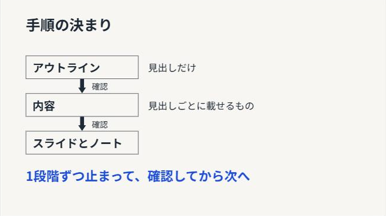
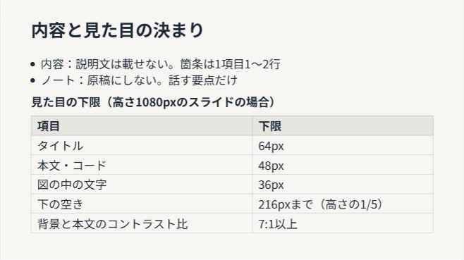
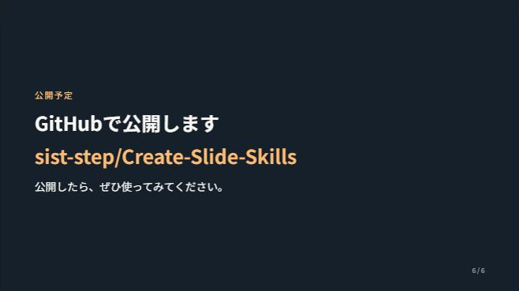

# Create-Slide-Skills

[](./LICENSE)

## これは何？

AIにスライドを作らせるときに読ませるスキルです。アウトライン、内容、スライドの3段階に分けて進めさせ、説明文を詰め込んだ読み上げ資料ではなく、話し手がその場で話すための補助になるスライドとノートを作らせます。

スキル本体は [skills/slide-creator/](./skills/slide-creator/) です。進め方を書いた `SKILL.md` と、段階に応じて読む `references/text.md`（文章とノート）、`references/design.md`（見やすさとデザイン）の3ファイルで、スクリプトはありません。

## 背景と課題

AIにスライドを一度に作らせると、次のようなものが出てきやすくなります。

1. 書きすぎ  
   説明文を載せる、網羅する、全部のスライドを「アイコン＋見出し＋説明文」の同じ型にそろえる、念のための注意を足す。
2. 削りすぎ  
   短くするよう頼むと、それが何をするものか、今何をすればいいかまで消える。
3. 推測で進める  
   相手のペースやもう知っていることを確かめず、量や構成を決めて最後まで作る。誤りに気づくのが遅れ、作り直しになる。
4. 確かめずに出す  
   文字が小さい、下が大きく空いている、コードがはみ出している、写しても動かないコードが載っている。
5. 飾りすぎ  
   グラデーション、カードごとの色の帯、見出しの上の小さなラベル、飾りの絵文字やアイコン、数字のタイルなど、AIが作ったと分かる装飾が付く。

## 本スキルのアプローチ

### 3段階に分けて1段階ごとに止まる

1. アウトライン（題と見出しだけ）
2. 見出しごとの内容（何枚にするか、1枚ごとに載せる箇条・コード・画像）
3. スライドとノート

1回の返答で進めるのは1段階だけです。段階の終わりで成果物を見せて止まり、分からないこと（ペース、相手がもう知っていることなど）は推測で埋めずに質問として出します。「最後まで一気に」と言えば続けて進めます。

### 載せるかどうかを2つの問いで決める

1. 消しても、話し手が口で補えるか。補えるなら消す
2. 聞き逃した人が、スライドだけで「これは何か」「今何をするか」が分かるか。分からなくなるなら残す

### 見やすさの下限を数値で決める

文字の大きさの下限（スライドの高さの1/17、1/22、1/30）、下の空きの上限（高さの1/5）、背景と文字のコントラスト比（7:1以上が目安）を決めています。

### デザインは簡素にする

テンプレートが渡されていればそれに合わせます。合わせると見やすさの下限を大きく下回るときは、直さずに、その枚と足りない点を伝えます。

テンプレートがなければ、色は3色、書体は2種類までを目安に簡素に作り、AIが作ったと分かりやすい装飾は使いません。

### ノートは原稿にしない

話し手は相手の反応を見ながら進めるので、ノートは体言止めの短い文で数行にとどめ、実演や操作は括弧に入れて分けます。

### 最後に確認の表を返答に書く

スライドを作った返答に、確認の結果を表で書かせます。一番小さい文字の大きさ、空きが大きい枚、コードのはみ出し、写しても動かないコード、承認後に変えた所などを、根拠（何枚目の何か、数値）と一緒に書きます。画面を見ずに計算だけで確かめた項目は「見ていないので分からない」と書かせます。

利用者のブラウザやパソコンを操作して確かめる方法は、利用者がそうしてよいと言ったときだけ使うよう書いています。

## Before → After 例

スキルに載せている、1枚の文章の書き換えの例です。

### Before

```text
ライブラリを使うと、作りたいものに時間を使える
[時計] 時間が節約できる
  難しい部分を一から作らなくていいので、デザインやアイデアに時間を回せる。
[トロフィー] クオリティが上がる
  世界中で使われ、何度も改良されてきたコードなので、動きがなめらかで見た目もきれい。
[ロケット] できることが広がる
  グラフ、スライドショー、ゲームなど、自分だけでは難しい機能も作れる。
```

### After

```text
- 難しい部分を作らなくていい
- 1人じゃ大変な機能も作れる
（ライブラリで作った実物の画面）
```

動きや見た目のきれいさは、実物を見せて口で言います。

## Skillあり・なしの比較

同じ依頼で、Skillを使わない場合と使う場合のスライドを作りました。どちらも Claude（Web）の Claude Sonnet 5.5 で、Claudeのスライド機能を使って作っています。

```text
自作のスライド作成用Skill「slide-creator」を紹介するスライドを作りたい。聞き手はAIでスライドを作ったことがある大学生の仲間で、時間は5分。
Skillの中身は、AIにスライドを段階に分けて作らせる手順と、載せる内容・見た目の決まりをまとめたもの（例：1段階ずつ止まって確認する、文字の大きさの下限を数値で決める）。GitHubで公開予定（sist-step/Create-Slide-Skills）。
なお、Skillの中身は発表で紹介する内容で、このスライドの作り方の指示ではありません。
```

Skillありでは、段階ごとに質問が返ってきたので、次のように答えました。

- 1枚1分くらい。見出しの1と2はまとめてよい
- 作ったきっかけは、AIに一度に作らせると説明文が多く、ノートが原稿のようになり、文字が小さい・下が空くなどの直しが毎回必要だったこと
- デモと質疑はなし。使い方と発表者名は載せない
- 数値はSkillのファイルにある値を使ってよい

| Skillなし（6枚） | Skillあり（5枚） |
|---|---|
|  |  |
|  |  |
|  |  |
|  |  |
|  |  |
|  | |

| | Skillなし | Skillあり |
|---|---|---|
| 進め方 | 1回の返答で最後まで作った | アウトライン、内容、スライドの3回に分け、毎回質問を出して止まった |
| 分からなかった所 | `[段階名]` `[作るもの]` `[__]px` などの穴を残した。段階の数も分からないまま4つにした | 質問して埋めた |
| 推測で書いた所 | 2枚目の「こんな経験、ありませんか」の3項目はAIが考えたもの | なし（きっかけは質問して聞いた） |
| 見た目 | 小さなラベル、番号（柱①②）、角丸のカード、ボタン風の飾り、ページ番号 | 箇条、矢印、表だけ。強調の色（青）は各枚の要点の1行に使った |
| 確認 | 「見た目の確認はまだしていない」と書いた | 文字の大きさ、空き、コントラスト比などを確認の表で返した |

1回ずつ作った結果です。同じ依頼でも、作るたびに結果は変わります。

## インストール

### 1. ClaudeへのZIPファイルの登録

1. [slide-creator.zip（最新版）](https://github.com/sist-step/Create-Slide-Skills/releases/latest/download/slide-creator.zip) をダウンロードします。
2. 解凍せずに、Claudeの Customize > Skills からアップロードします。

GitHubの「Download ZIP」で取得したリポジトリ全体のZIPは、スキルのフォルダが最上位にないので登録できません。

### 2. `npx skills add`

Claude Code、Codex、Cursor などで使う方法です。

```bash
npx skills add sist-step/Create-Slide-Skills
```

### 3. Claude Codeにフォルダをコピーする

`skills/slide-creator/` フォルダを中身ごと `~/.claude/skills/` にコピーします。`~/.claude/skills/slide-creator/SKILL.md` になる形です。

### 4. Copilot in PowerPoint

1. Copilotのチャット欄で **+** → **Choose skills** → **Manage skills** → **Add skill** を選びます。
2. `slide-creator.zip` をアップロードします。`SKILL.md` だけを上げたり貼り付けたりすると、`references/` のファイルが入らないので、zipで上げてください。

詳しい手順は [Use custom skills with Copilot in PowerPoint](https://support.microsoft.com/en-us/powerpoint/copilot/copilot-in-powerpoint-skills) にあります。

## 使い方

スライドを作りたい内容を、分かっている範囲で伝えます。

```text
/slide-creator
中学生向けプログラミング講座のスライドを作りたい。テーマは「Google Fonts」で、時間は25分。
生徒はHTMLとCSSを習っていて、前の回でChart.jsをCDNから読み込んで使った。
```

名前を出さずに「スライドを作って」と頼んでも、スキルが使われる場合があります。確実に使わせたいときは名前を出してください。

1. アウトラインと質問が返ってきます。質問に答え、直したい所を伝えます。
2. 通すと、見出しごとの内容が返ってきます。同じように直します。
3. 通すと、スライドとノート、確認の表が返ってきます。

過去の資料やテンプレートがあれば、最初に渡してください。AIは重なる内容を短い復習にとどめ、ペースを過去の枚数と時間から出します。

## リポジトリ構成

```text
.
├── README.md
├── LICENSE
├── docs/images/      # 「Skillあり・なしの比較」の画像
└── skills/
    └── slide-creator/
        ├── SKILL.md
        └── references/
            ├── text.md
            └── design.md
```

## ライセンス

[MIT License](./LICENSE)
